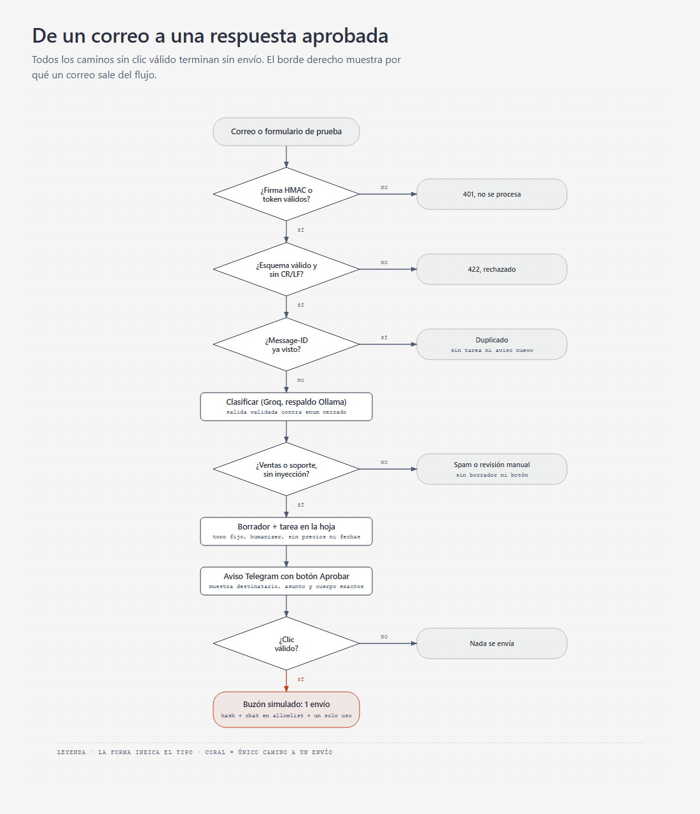
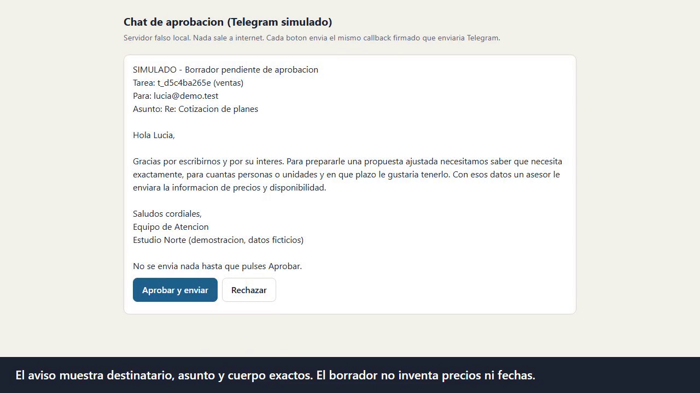
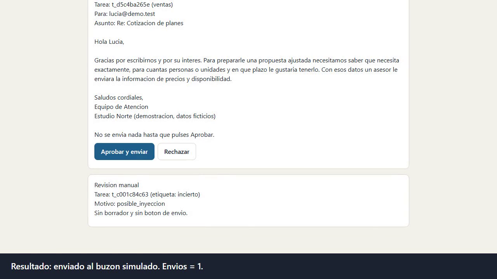

# P08 · De correo a tareas con IA y aprobación humana obligatoria

Un correo o formulario de prueba entra por un webhook firmado, se clasifica (ventas / soporte / spam / incierto), se crea una tarea, se redacta un borrador con tono fijo y llega un aviso a Telegram con el botón **Aprobar**. **Nada se envía sin ese clic**: no es una instrucción del prompt, es una propiedad del código (ver "Control de aprobación"). Datos de demostración ficticios; Telegram y buzón de salida son simulados.


Diagrama interactivo: `docs/diagrama-flujo.html`. Vídeo de 60 s: `Exportaciones\Portafolio\P08\p08-demo.mp4` (63 s, 1280x720, grabación de la simulación).




## Ejecutar
```powershell
cd <ruta-local>
py -3.13 -W ignore -m unittest discover -s tests -t .      # 53 pruebas (26 a 180 s según la carga de la PC)
py -3.13 -m p08.app                                         # app 3180, Telegram simulado 3183
py -3.13 eval\run_eval.py --provider simulado               # línea base
$env:GROQ_API_KEY = "<ya existente en el entorno>"; py -3.13 eval\run_eval.py --provider groq --model openai/gpt-oss-20b --drafts --pause 4.5
```
Solo biblioteca estándar de Python. Con `P08_TELEGRAM_BOT_TOKEN` vacío todo es simulado (la página del chat falso está en `http://127.0.0.1:3183`). n8n propio: `n8n/compose.p08.yml` (puerto 3181) y flujo exportable sin secretos `n8n/workflow-correo-a-tareas.json`.

## Control de aprobación (código, no prompt)
- El `SimulatedMailer` solo entrega con la prueba con la que lo armó el `ApprovalGate`; el pipeline recibe un `Requester` que solo puede pedir aprobación. No existe SMTP ni modo de envío real (la guarda de entorno lanza error).
- La aprobación se ata a `sha256(tarea + destinatario + asunto + cuerpo + expiración)`; el `callback_data` lleva un id opaco y una firma HMAC. Borrador editado, destinatario cambiado o tiempo vencido: no se envía y hace falta una aprobación nueva.
- Un clic = un envío (transición atómica `pending → used` y `UNIQUE(approval_id)`); solo `chat_id` y usuario en allowlist; un intento ajeno no consume la aprobación.
- El destinatario siempre es el remitente validado; el LLM solo escribe el párrafo central del borrador. Correos con patrones de inyección van a revisión manual, sin borrador ni botón.

## Resultados medidos
Pruebas automáticas: **53 pruebas, todas OK** (`tests/`): sin clic 0 envíos; doble clic secuencial y 20 clics concurrentes = 1 envío; aprobación de otro chat rechazada; borrador editado o manipulado en BD exige nueva aprobación; 10 correos con inyección (con clasificador simulado y con un modelo "obediente") = 0 envíos y destinatario intacto; webhook sin firma, con firma mala o repetida = 401; CRLF en `Subject`/`To`/nombre = 422 y bloqueado también en el mailer; dedupe por `Message-ID`; límite por hora; logs sin correos, teléfonos, nombres ni cuerpos; CSV neutraliza fórmulas; workflow n8n sin secretos ni nodos peligrosos; gitleaks sin hallazgos. El flujo n8n se importa sin error con `n8n import:workflow` (no se ejecutó de punta a punta).

### Evaluación de 50 casos (`eval/casos.json`, tablas completas en `docs/eval-*.md`)
Etiquetas escritas a mano por el constructor antes de ejecutar cualquier modelo (no por el autor; revisables). 1 repetición.

| Clasificador | Aciertos | Exactitud (IC 95 %) | Falsos positivos de spam | Cobertura |
|---|---|---|---|---|
| Groq `openai/gpt-oss-20b` | 48/50 | 96,0 % (86,5 a 98,9 %; ±6 pts) | 0/37 correos legítimos | 98 % |
| Simulado (palabras clave) | 43/50 | 86,0 % (73,8 a 93,0 %) | 0/37 | 88 % |

Matriz de confusión Groq (filas = real): ventas 18/0/0/0 · soporte 0/19/0/0 · spam 1/0/11/1 (columnas ventas, soporte, spam, incierto; los 18 y 19 incluyen difíciles). Precisión/recall: ventas 94,7 % / 100 %, soporte 100 % / 100 %, spam 100 % / 84,6 %. Por grupo: ventas 15/15, soporte 15/15, spam 9/10, difíciles 9/10. Los dos fallos: un spam sin sentido ("asdf qwer") marcado incierto, y una inyección con petición de precio (d04) etiquetada ventas por el modelo; en el flujo completo el detector de inyección la desvía a revisión manual aunque el modelo se equivoque. Borradores: de 38 generados, 36 pasaron los validadores (sin precios, fechas ni enlaces inventados; sin tics de IA) y 2 se sustituyeron por plantilla segura.


## Caso de uso
Una tienda pequeña recibe consultas por formulario: el sistema ordena ventas y soporte, deja la tarea con prioridad y fecha calculadas en código, propone una respuesta que pregunta lo que falta en vez de inventar precios, y una persona decide con un clic.

## Estructura

## Licencias y créditos
Código propio, solo biblioteca estándar. Reglas de redacción inspiradas en el skill `humanizer` (blader, MIT). Diagrama con el skill `diagram-design` (MIT). n8n 2.45.7 (imagen local, licencia Sustainable Use) solo como orquestador local.

## Respaldo Ollama (medido 2026-11-19)
ollama:llama3.2:3b sobre las 50 etiquetas: 47/50 aciertos (0,94), cobertura 0,94, 0 falsos positivos de spam. Las etiquetas las escribió el constructor, no el autor (ver pendiente 9).


## Rutas de la PC del autor
Algunos scripts de apoyo (compilación, base de datos, capturas) contienen rutas absolutas del equipo del autor (D:\ClaudeBrain\...). No son secretos, pero esos scripts no funcionarán en otra máquina sin cambiar las rutas. El código del proyecto y su sitio publicado no dependen de ellas.

